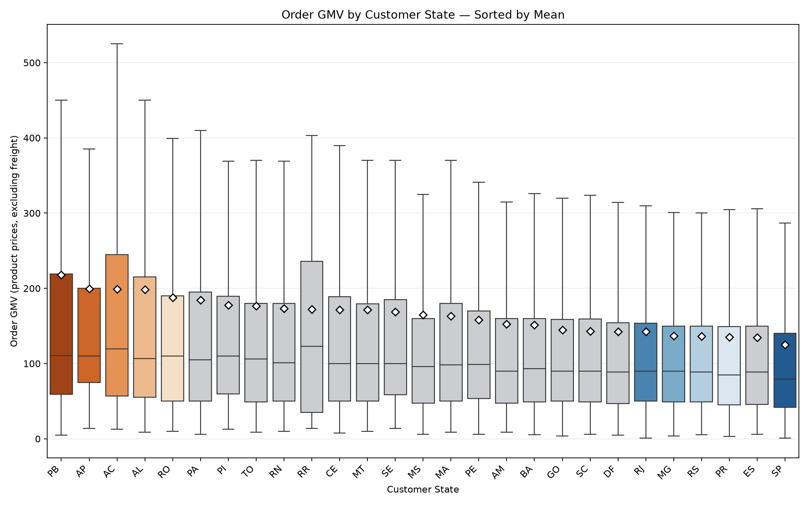
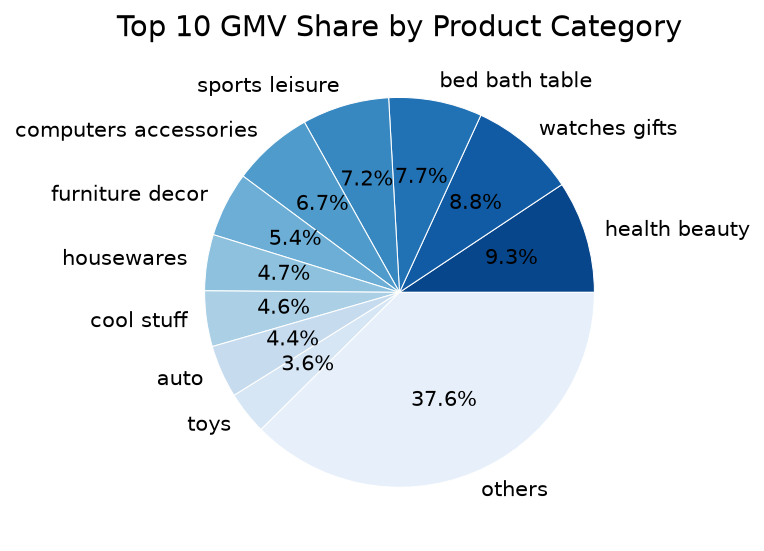
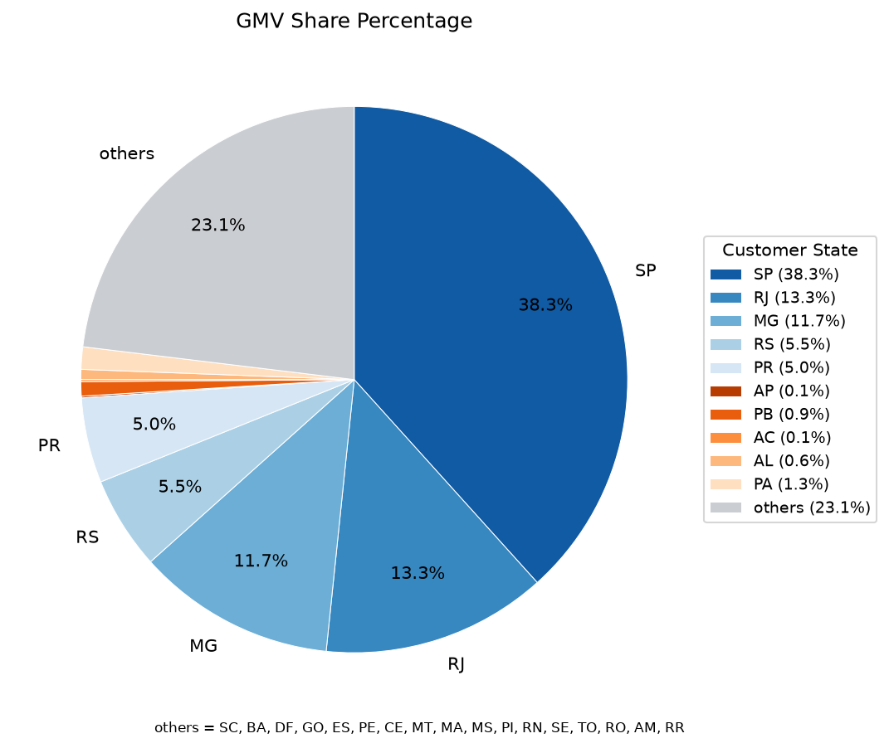
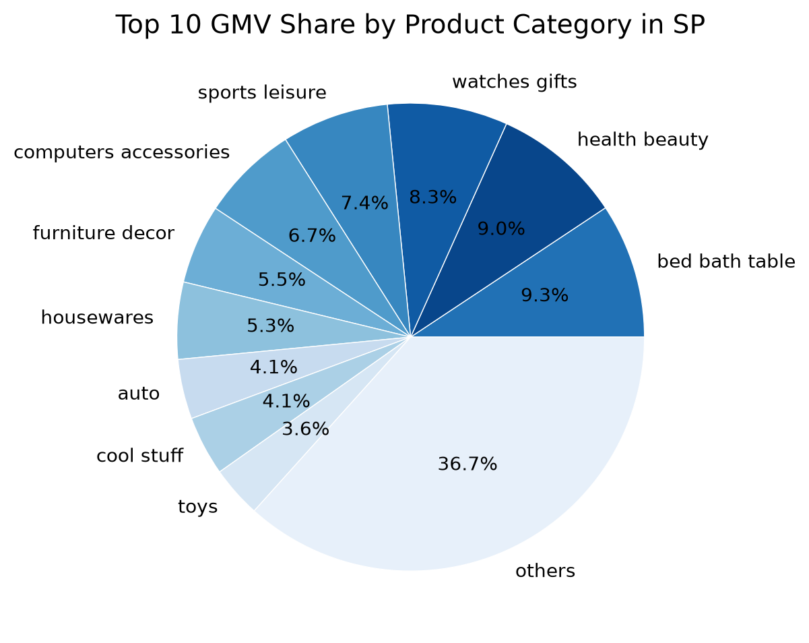
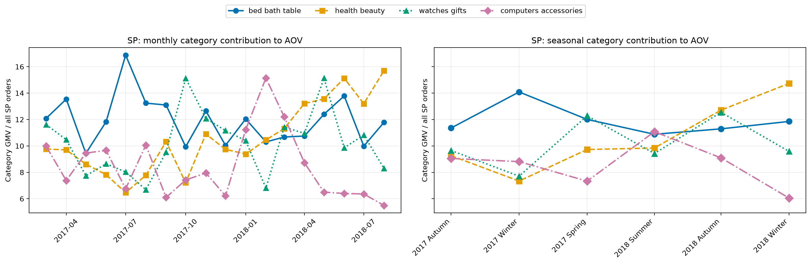
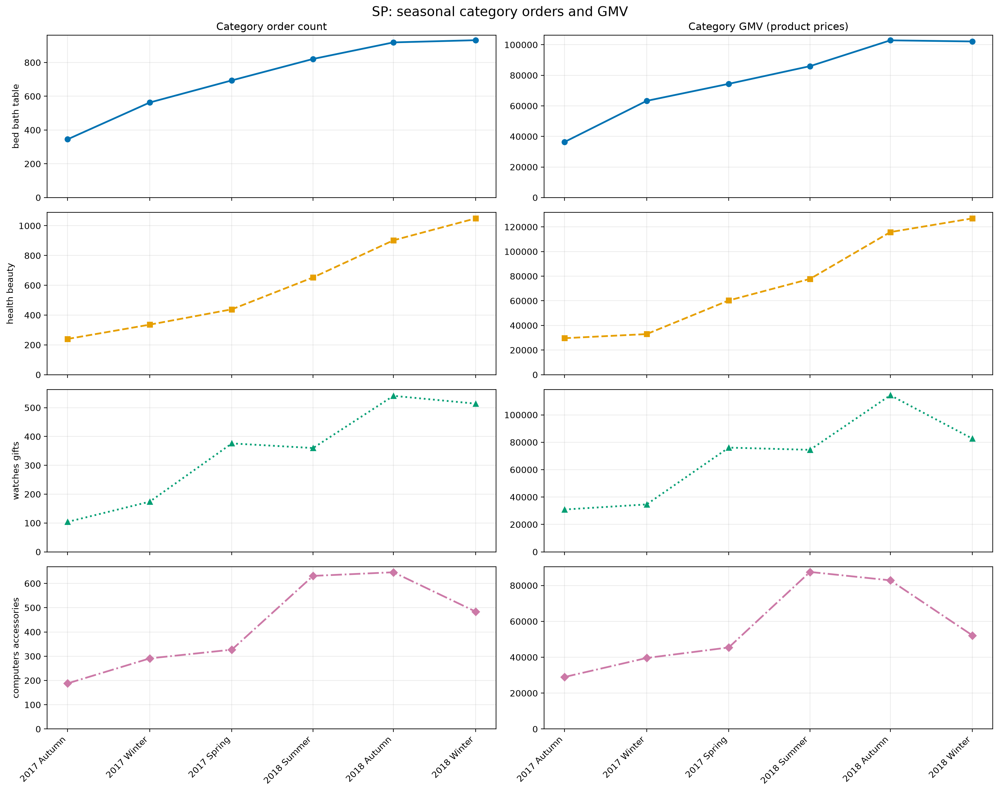

# AWS_Python_data_analysis

Olist のブラジル EC データを用いて、低評価レビューのリスクを分析・予測し、その要因と将来の購買・GMVとの関係を検証するデータ分析ポートフォリオです。
AWS（Amazon S3 / Athena）と SQL で分析用データを作成し、Python（Positron, VS Code / Jupyter Notebook）で統計分析・機械学習・売上構造分析を行っています。

## 1. 分析で明らかにしたいこと

> **注文・配送・商品・地域情報から低評価になりやすい注文を識別し、
> その要因や対象セグメントを理解したうえで、
> 低評価とその後の再購入・将来 GMV の関係を明らかにできるか。**

本プロジェクトは、次の2段階で進めます。

1. **予測分析**
   - 低評価レビュー（1〜2点）の予測
   - Baseline モデルから追加特徴量を加えた Improved モデルへの改善
   - 将来期間を用いた時系列 Holdout 評価

2. **ビジネスへの影響分析**
   - 低評価 / 高リスク注文と、その後の再購入・注文数・将来 GMV との関係を確認
   - 施策効果そのものではなく、低評価対策が関係しうる売上規模・顧客行動を定量的に把握

> **注意**
> Olist データは観察データであり、介入実験の結果は含まれていません。
> そのため、本プロジェクトでは「施策によって GMV が増加する」といった因果効果は直接推定しません。

---

## 2. 分析全体の流れ

```text
Olist Dataset
    │
    ▼
Amazon S3
    │
    ▼
Amazon Athena / SQL
    │
    ▼
分析用データ作成
    │
    ├───────────────────────────────┐
    ▼                               ▼
顧客体験に関する分析      　　 売上・顧客層の探索
・注文金額                      ・GMV / AOV
・送料                          ・顧客州
・配送遅延                      ・商品カテゴリ
・レビュー評価                   ・月 / 季節
    │                          ・商品構成
    ▼                               │
低評価予測モデル                     │
    │                               │
    └──────────────┬────────────────┘
                   ▼
              特徴量の追加
                   │
                   ▼
              モデルの改良
                   │
                   ▼
            　将来期間で評価
                   │
                   ▼
     実際のレビュー・再購入・将来売上を確認
```

## 現在位置

現在は以下まで完了しています。

- Customer Experience Analysis
- Baseline 低評価予測モデル
- Train / Validation / Test に分けたモデル評価
- GMV / AOV の基準集計
- 州・カテゴリ・時期・商品構成の探索
- Notebook 共通処理の `src/` への整理
- SP 州の一部カテゴリについて、GMV 変化を注文数と注文あたり GMV に分解

低評価予測モデルの特徴量比較を実施し、ロジスティック回帰では注文・地域・購入時期の特徴量を用いたModel Aを代表モデルとして選択しました。

その後、時系列クロスバリデーションによる性能の安定性を検証し、予測時点とデータ分割の整合性を見直しています。

本モデルは配送完了時点で低評価リスクを予測することを想定していますが、従来の時系列分割は購入月を基準としていました。モデルデータ95,824注文のうち36,091注文（約37.7%）で購入月と配送完了月が異なることを確認したため、現在は配送完了日時を基準とした時系列評価の再設計を進めています。

評価方法を確定した後、Random Forest・XGBoost・LightGBM・CatBoostなどのモデル比較に進む予定です。
---

## 3. 使用データ
- **データセット:** [Brazilian E-Commerce Public Dataset by Olist](https://www.kaggle.com/datasets/olistbr/brazilian-ecommerce)
- **主なデータ:** 注文、商品、送料、支払い、レビュー、配送に関する情報（orders / customers / order_items / payments / reviews / products / sellers）
- **ライセンス:** [CC BY-NC-SA 4.0](https://creativecommons.org/licenses/by-nc-sa/4.0/)
- **データの保管:** 元データと分析用CSVは`data/`に保存し、GitHubには含めていません。`data/`は`.gitignore`で除外しています。

---

## 4. 使用技術・分析環境

- **AWS:** Amazon S3、Amazon Athena
- **SQL:** Athena用クエリ
- **Python**：pandas、NumPy、SciPy、scikit-learn、matplotlib、scikit-posthocs など
- **分析手法:** 記述統計、箱ひげ図、Kruskal–Wallis検定、Dunn検定（Bonferroni・Holm補正）、ロジスティック回帰
- **開発環境**：Positron、Jupyter Notebook
- **環境管理**：Docker、requirements.txt
- **バージョン管理**：Git、GitHub、SourceTree


---

## 5. リポジトリ構成

本プロジェクトでは、SQLによるデータ加工、Python・Rによる統計解析、機械学習、結果の可視化を分離し、分析過程を再現・追跡できる構成としています。

### 5.1 ディレクトリ構成

```text
AWS_Python_data_analysis/
├── .devcontainer/
│   ├── gpu/
│   │   └── devcontainer.json       # GPU用Dev Container設定
│   ├── devcontainer.json           # CPU用標準設定
│   └── Dockerfile                  # 共通のPython実行環境
├── .positron/
│   ├── extensions.json
│   ├── launch.json
│   └── settings.json
├── data/                            # ローカルデータ（Git管理対象外）
├── docs/
│   └── development_log.md          # 開発履歴
├── images/                          # 分析結果の画像（25点）
├── notebooks/                       # Notebook 13本・Rスクリプト1本
├── sql/
│   └── athena/                     # AWS Athena用SQL（29本）
├── src/                             # 共通Pythonモジュール
│   ├── __init__.py
│   ├── README.md
│   ├── analysis_plots.py
│   ├── bootstrap.py
│   ├── model_metrics.py
│   ├── model_summary.py
│   ├── model_training.py
│   ├── order_value_state_plots.py
│   ├── project_paths.py
│   ├── review_stats.py
│   └── sales_metrics.py
├── .dockerignore
├── .gitignore
├── requirements.txt
└── README.md
```

※ 上記は主要なディレクトリとファイルを示しています。`data/` はGit管理対象外であり、GitHubには含まれません。

### 5.2 Notebookの構成

`notebooks/` には、分析目的・処理内容・実行結果・解釈を記録しています。

| ファイル | 主な分析内容 |
|---|---|
| `1_review_price_analysis.ipynb` | レビュー評価と注文金額・送料の関係 |
| `2_review_delivery_analysis.ipynb` | レビュー評価と配送遅延の関係 |
| `3_predict_low_review.ipynb` | 低評価予測モデルの基礎分析 |
| `4_sales_baseline_by_month_state.ipynb` | 月別・州別の売上基礎分析 |
| `5_sales_by_category_state.ipynb` | 商品カテゴリ別・州別売上分析 |
| `6_order_level_sales_by_state.ipynb` | 注文単位の州別売上分析 |
| `7_promotion_candidate_by_state_category.ipynb` | 州・カテゴリ別の販促候補分析 |
| `8_state_aov_category_decomposition.ipynb` | 州別AOVのカテゴリ構成分析 |
| `9_monthly_seasonal_category_by_state.ipynb` | 月別・季節別のカテゴリ動向 |
| `10_sp_product_mix_winter_comparison.ipynb` | サンパウロ州の商品構成と冬季の比較 |
| `11_low_review_feature_engineering.ipynb` | 低評価予測の特徴量設計・改善 |
| `12_low_review_future_purchase_analysis.ipynb` | 低評価と将来の再購入・GMVの関連分析 |
| `13_low_review_model_comparison.ipynb` | 低評価予測の特徴量セット・モデル比較 |
| `review_score_analysis.R` | Rによるレビュー評価の統計解析 |

### 5.3 SQLの構成

`sql/athena/` では、AWS S3上のOlistデータをAthenaで加工し、分析用テーブルや特徴量を生成します。

SQLは処理の順序に沿って連番で管理しています。

| SQL番号 | 主な用途 |
|---|---|
| 01〜08 | データベース・外部テーブルの作成、基本データの結合 |
| 09〜13 | レビュー評価、注文金額、送料、配送遅延の集計 |
| 14〜15 | 月別・州別の売上集計とデータ件数の照合 |
| 16〜21 | 商品カテゴリの翻訳・地域別売上・季節性・商品構成分析 |
| 22〜25 | 注文構成・支払い・商品カテゴリ・顧客履歴の特徴量生成 |
| 26 | 購入期間の確認 |
| 27〜29 | レビュー投稿を基準とする将来購買分析、再購入関連の調整変数生成 |

主に、注文ID単位で重複のない分析データを生成し、Pythonでの統計解析や機械学習に利用しています。

### 5.4 共通Pythonモジュール

再利用可能な処理は `src/` に配置しています。

| ファイル | 役割 |
|---|---|
| `analysis_plots.py` | 分析結果の可視化 |
| `bootstrap.py` | ブートストラップによる推定 |
| `model_metrics.py` | 分類モデルの評価指標・しきい値評価 |
| `model_summary.py` | モデル結果の集計・整理 |
| `model_training.py` | 前処理とモデル学習 |
| `order_value_state_plots.py` | 注文金額・地域別分析の可視化 |
| `project_paths.py` | ディレクトリパスの共通管理 |
| `review_stats.py` | レビュー評価に関する統計処理 |
| `sales_metrics.py` | 売上関連指標の集計 |
| `README.md` | 共通モジュールの説明 |

共通処理をモジュール化することで、Notebook間の重複コードを減らし、同じ評価・集計方法を再利用できるようにしています。

### 5.5 分析結果の画像

`images/` には、各Notebookで生成した図を保存しています。

画像は主に次のテーマに分類できます。

- レビュー評価と注文金額・送料・配送遅延
- 月別GMV・注文数・AOV
- 州別売上・注文金額分布
- 商品カテゴリ別GMVと売上構成比
- 州別の商品構成と季節変動

図表はREADMEおよびNotebookから参照し、分析結果を視覚的に確認できるようにしています。

### 5.6 分析環境の再現方法

本プロジェクトではPython 3.12を使用し、`requirements.txt` とDocker Dev Containersによって実行環境を管理しています。

#### CPU・GPU対応のDocker環境

CPU用とGPU用の2種類のDev Container設定を用意しています。

| 環境 | 設定ファイル | 用途 |
|---|---|---|
| CPU（標準） | `.devcontainer/devcontainer.json` | 統計解析・通常の機械学習 |
| GPU | `.devcontainer/gpu/devcontainer.json` | NVIDIA GPUを利用した学習 |

両構成は共通のDockerfileと `requirements.txt` を使用します。

GPU環境では、コンテナ起動時に `--gpus all` を指定します。

GPUを使用しない場合は、CPU用のDev Containerを選択します。

#### GPU動作確認

NVIDIA GeForce RTX 4070 Tiを使用して、以下の動作を確認しました。

- Windows・WSL 2・Docker Desktop経由でのGPU認識
- XGBoost 3.4.1によるGPU学習
- CatBoost 1.2.10によるGPU学習
- LightGBM 4.7.0のインポート成功

43,000件・数値特徴量20個・決定木500本の人工分類データによるベンチマークでは、次の結果でした。

| モデル | CPU実行時間 | GPU実行時間 |
|---|---:|---:|
| XGBoost | 0.742秒 | 0.784秒 |
| CatBoost | 1.358秒 | 16.134秒 |

今回の条件ではGPUによる高速化を確認できなかったため、CPUを標準環境としています。

なお、測定は各1回であり、実際のOlistデータで同様の速度差が生じることを保証するものではありません。

#### ローカルPython環境

Dockerを使用しない場合は、Python 3.12環境で以下を実行します。

```bash
python -m pip install -r requirements.txt
```

Linux環境では、LightGBMの利用にOpenMPライブラリ（`libgomp1`）が必要になる場合があります。Dockerfileでは、この依存関係を管理しています。

#### データの管理

分析用のCSVなどは `data/` に保存しますが、Git管理対象外としています。

このため、GitHubのコードを取得してPython環境を構築するだけでは、Notebookのすべての分析を直ちに再実行できるわけではありません。

元データの取得と、AWS Athenaによる集計・特徴量生成が必要です。

---

## 6. 主な分析結果

### 6.1 注文金額・送料とレビュー評価

注文に複数の商品が含まれることを考慮し、商品明細を注文単位へ集約してからレビュー情報と結合しました。

| Variable | Kruskal–Wallis H | p-value | ε² |
|---|---:|---:|---:|
| Total Price（価格） | 299.1710 | < 0.001 | 0.003015 |
| Total Freight （送料）| 932.2902 | < 0.001 | 0.009481 |

統計的な差は確認されましたが、効果量は小さく、**大規模サンプルでは p 値だけでなく効果量も確認する必要がある**ことを確認しました。

Notebook: [`1_review_price_analysis.ipynb`](notebooks/1_review_price_analysis.ipynb)

---

### 6.2 配送遅延とレビュー評価

```text
配送遅延日
= 実際の配送日 - 配送予定日
```

- 負の値: 予定より早く配送
- 0: 予定どおり
- 正の値: 予定より遅く配送

分析対象は 95,830 注文です。

| レビュー評価 | 配送遅延中央値 |
|---:|---:|
| 1 | -7 days |
| 2 | -10 days |
| 3 | -11 days |
| 4 | -12 days |
| 5 | -13 days |

- Kruskal–Wallis: H = 3890.1397, p < 0.001
- ε² = 0.040555
- Dunn 検定では全レビュー評価群間で有意差
- Review 1 vs 5 のペアでは中程度の効果量（δ = 0.3710）を確認

低評価の注文ほど、予定配送日との差が遅延側に位置する傾向が確認されました。

ただし、これは観察データ上の関連であり、配送遅延が低評価を引き起こしたことを示すものではありません。

Notebook: [`2_review_delivery_analysis.ipynb`](notebooks/2_review_delivery_analysis.ipynb)

### 6.3 低評価と90日以内の再購入・将来GMV

レビュー投稿後90日間の購買行動を追跡可能な74,185注文を対象に、低評価と将来の顧客行動の関連を分析しました。

低評価はレビュー評価1〜2点、通常評価は3〜5点と定義しました。

#### 90日以内の再購入率

| 指標 | 通常評価 | 低評価 |
|---|---:|---:|
| 対象注文数 | 63,206 | 10,979 |
| 再購入注文数 | 790 | 104 |
| 再購入率 | 1.2499% | 0.9473% |

Fisherの正確確率検定では、低評価群の再購入率が統計的に有意に低い結果でした。

- オッズ比：0.756
- p値：0.00685
- 再購入率の差：-0.303ポイント

さらに、購入時期・過去注文回数・配送完了状況を調整したロジスティック回帰を実施しました。

同一顧客による複数観測を考慮し、顧客単位のクラスターロバスト標準誤差を使用しました。

- 調整オッズ比：0.742
- 95%信頼区間：0.587〜0.938
- p値：0.0126

調整後も、低評価と90日以内の再購入には統計的に有意な負の関連が認められました。

#### 90日以内の将来GMV

GMVは送料を含まない商品価格合計として集計しました。

| 指標 | 通常評価 | 低評価 |
|---|---:|---:|
| 全注文の平均将来GMV（BRL） | 1.663 | 1.505 |
| 再購入ありの平均将来GMV（BRL） | 133.03 | 158.87 |

将来GMVは約98.8%の注文で0となるため、平均差をブートストラップで評価しました。

顧客単位クラスターブートストラップ（2,000回）の結果：

| 分析対象 | 平均GMV差（低評価−通常評価） | 95%信頼区間 |
|---|---:|---|
| 全注文 | -0.158 BRL | -0.655〜0.430 |
| 再購入あり | +25.843 BRL | -12.247〜73.609 |

いずれも95%信頼区間に0を含み、平均将来GMVの明確な群間差は確認できませんでした。

#### ビジネス上の示唆

低評価はその後の再購入率と負の関連を示しており、低評価リスクを早期に検知するモデルは、顧客フォロー対象の優先順位付けに活用できる可能性があります。

一方、将来GMVとの明確な関連は確認できていません。

これらは観察データ上の関連であり、低評価への介入によって再購入率や売上が改善するという因果効果を示すものではありません。

Notebook: `12_low_review_future_purchase_analysis.ipynb`

## 7. 低評価予測の基準モデル

レビュー 1〜2 点を低評価として二値分類しました。

```text
low_review = 1  if review_score <= 2
low_review = 0  if review_score >= 3
```

### 使用した特徴量

- `注文金額`
- `送料`
- `配送遅延日数`

### モデル

- Logistic Regression（ロジスティック回帰）
- StandardScaler を Train データのみに fit
- Train / Validation / Test = 60 / 20 / 20
- Validation 上で F1-score が最大となるしきい値を選択
- threshold = **0.24**

### テストデータでの評価結果

| テスト指標 | 結果 |
|---|---:|
| Accuracy | 0.8860 |
| Precision | 0.5919 |
| Recall | 0.3472 |
| F1-score | 0.4377 |
| ROC-AUC | 0.6838 |

Test データでは、低評価 2,448 件のうち 850 件を検出しました。

低評価率は約 12.77% とクラス不均衡があるため、Accuracy だけでなく Precision / Recall / F1 / ROC-AUC を併記しています。

### 標準化後のオッズ比

| 特徴量 | オッズ比 |
|---|---:|
| 注文金額 | 1.014 |
| 送料 | 1.265 |
| 配送遅延日数 | 2.154 |

今回の3つの特徴量では、配送遅延日数の関連が最も大きいことが分かりました。

### このモデルの限界

`delivery_delay_days` は配送完了後に確定する情報です。

そのため、この Baseline モデルは「購入時点の予測モデル」ではなく、**配送完了後〜レビュー投稿前のフォロー対象候補を考えるモデル**として解釈する方が自然です。

Notebook: [`3_predict_low_review.ipynb`](notebooks/3_predict_low_review.ipynb)

### 時系列Validationによる特徴量改善

将来の注文に対する予測性能を評価するため、時系列によるTrain / Validation / Holdout分割を導入しました。

| データ | 期間 | 注文数 |
|---|---|---:|
| Train | 〜2017年12月 | 43,362 |
| Validation | 2018年1〜4月 | 27,220 |
| Holdout | 2018年5〜8月 | 25,242 |

Holdoutは最終評価まで使用せず、特徴量やしきい値の比較はValidationで実施しています。

注文構成、送料割合、顧客の州、支払い方法、購入月、商品カテゴリ、過去購買履歴などの特徴量を順次追加しました。

| モデル | Validation F1 | Validation ROC-AUC |
|---|---:|---:|
| Baseline（時系列分割） | 0.5417 | 0.7415 |
| 注文構成・地域・月を追加 | 0.5515 | 0.7661 |
| 支払い特徴量を追加 | 0.5511 | 0.7667 |
| 購入月をsin/cosで表現 | 0.5515 | 0.7670 |
| 商品カテゴリを追加 | 0.5372 | 0.7704 |
| 過去購買履歴を追加 | 0.5366 | 0.7700 |

商品カテゴリの追加によりROC-AUCは若干改善した一方、F1は低下しました。

また、過去購買履歴の追加による性能改善は限定的でした。

この結果から、特徴量を増やすことが必ずしも予測性能の改善につながるわけではないことが確認されました。

特徴量セットA〜Dを同一のValidation期間で比較した結果、Model AはF1が0.5520、Average Precisionが0.5200となり、両指標で最良でした。そのため、ロジスティック回帰の代表モデルとしてModel Aを選択しました。

なお、これらの結果は購入月を基準とした時系列分割による暫定評価です。

その後の検証で、予測時点である配送完了日時と購入月が一致しない注文が約37.7%存在することが判明しました。このため、現在は配送完了日時を基準とした評価方法を検討しています。

新しい評価設計を確定した後、各モデルを同じ条件で比較し、未使用のHoldoutで最終評価する予定です。

Notebook: `11_low_review_feature_engineering.ipynb`、`13_low_review_model_comparison.ipynb`
---

## 8. 売上・特徴量候補の探索

この売上分析は、販促効果を直接推定するためではなく、

> **低評価予測モデルの追加特徴量候補と、後続のビジネスでの影響分析で確認すべきセグメントを整理する**

目的で実施しています。

### 8.1 売上（GMV）と平均注文額（AOV）の 基準集計

GMV：商品価格の合計
AOV：1注文あたりの平均金額

この分析では、GMVとAOVを以下のように定義しています。

```text
GMV = Σ item price
AOV = GMV / unique orders
```

- 対象注文: 96,478
- 期間: 2016-09 〜 2018-08
- GMV: 13,221,498.11
- 送料: 2,198,275.64
- 全体 AOV: 137.04
- 最大州: SP
  - 注文数: 40,501
  - GMV: 5,067,633.16
  - AOV: 125.12

Notebook: [`4_sales_baseline_by_month_state.ipynb`](notebooks/4_sales_baseline_by_month_state.ipynb)

### 8.2 州別の注文金額比較

| 州 | 注文数 | 平均注文額 | 注文額中央値 |
|---|---:|---:|---:|
| PB | 517 | 217.77 | 110.32 |
| AP | 67 | 199.62 | 109.90 |
| AC | 80 | 199.14 | 119.45 |
| AL | 397 | 198.63 | 106.90 |
| PA | 946 | 184.43 | 105.00 |
| SP | 40,501 | 125.12 | 79.50 |




箱の中央線は**注文1件ごとのGMVの中央値**、白いひし形は平均値です。

- Kruskal–Wallis: H = 732.3388, p < 0.001
- 27 州 351 ペアのうち、Dunn 検定（Holm 補正）で 77 ペアが有意
- SP と AP / AC / PB / AL の差は統計的に確認されたが、効果量は小さい

小規模州では少数注文の影響が大きいため、平均注文額が高いことだけで施策対象とは判断していません。

Notebook: [`6_order_level_sales_by_state.ipynb`](notebooks/6_order_level_sales_by_state.ipynb)

---

### 8.3  州別・商品カテゴリ別の分析

- 27 州
- 74 カテゴリ（`カテゴリ未分類` を含む）
- 1,388 州 × カテゴリ

全体 GMV 上位:

1. `health_beauty`: 1,233,131.72
2. `watches_gifts`: 1,166,176.98
3. `bed_bath_table`: 1,023,434.76



州別 GMV 上位:

- SP: 5,067,633.16
- RJ: 1,759,651.13
- MG: 1,552,481.83




全体と州内で上位カテゴリが異なり、地域によって商品構成が異なる可能性があることを確認しました。

Notebook: [`5_sales_by_category_state.ipynb`](notebooks/5_sales_by_category_state.ipynb)

---

### 8.4 商品カテゴリの購入割合

```text
カテゴリ購入割合
= そのカテゴリを含む注文数 / 州全体の注文数
```

例: `bed_bath_table`

| 州 | カテゴリ購入割合 |
|---|---:|
| SP | 10.73% |
| AL | 4.53% |
| PA | 3.59% |



売上額だけでなく、**その州でそのカテゴリを含む注文がどの程度あるか**を分けて確認しています。

---

### 8.5 月別・季節別の商品カテゴリ分析

ブラジルの季節区分:

- 夏: 12月–2月
- 秋: 3月–5月
- 冬: 6月–8月
- 春: 9月–11月

**あるカテゴリが州全体の平均注文額（AOV）にどれくらい寄与しているか**を以下で表します。

```text
平均注文額へのカテゴリ寄与額
= カテゴリGMV / 州全体の注文数
```

さらに、

```text
平均注文額へのカテゴリ寄与額
= カテゴリ購入割合
  × カテゴリGMV / カテゴリ注文数
```

と分解できます。これにより、
「そのカテゴリがよく買われているから寄与が大きいのか（カテゴリ購入割合）」
「そのカテゴリを買ったときの金額が高いから寄与が大きいのか（カテゴリあたりのGMV）」
を分けて検討しています。



SP の `health_beauty` では 2017 年冬 → 2018 年冬に以下の変化を確認しました。

| 指標 | 2017 年冬 | 2018 年冬 |
|---|---:|---:|
| カテゴリ注文数 | 336 | 1,049 |
| 州全体の注文数 | 4,492 | 8,617 |
| カテゴリ購入割合 | 7.48% | 12.17% |
| カテゴリGMV / カテゴリ注文数 | 98.14 | 120.99 |
| AOV 寄与額 | 7.34 | 14.73 |



このことから、SP州のhealth_beautyは、2018年冬には**より多くの注文で買われるようになり、かつ1注文あたりのカテゴリGMVも高くなった**ため、州全体の平均注文額への寄与が大きくなったと解釈できます。

Notebook: [`9_monthly_seasonal_category_by_state.ipynb`](notebooks/9_monthly_seasonal_category_by_state.ipynb)

---

### 8.6 GMV変化の要因分解

ここでは、GMVが増えた理由を「注文件数」と「1注文あたり金額」に分けています。

```text
GMV = カテゴリ注文数 × カテゴリ注文数あたりのGMV
```

SP の `health_beauty` では、2017 年冬 → 2018 年冬の GMV 増加 93,946.95 を、

- 注文件数変化分: 69,974.50
- 注文あたり GMV 変化分: 23,972.45

に分解しました。
このことから、GMV増加は１注文の値段の増加より、注文件数変化（増加）が寄与していることが分かりました。

---

### 8.7 商品構成の変化

SP州の`health_beauty`について、2017年冬と2018年冬の商品構成を比較しました。

- 商品数：173 → 535
- 両期間に共通する商品：20
- 2018年冬にのみ登場した商品：515
- 2018年冬のカテゴリGMV：126,922.31
- 2018年冬にのみ登場した商品群のGMVシェア：約90.5%

2018年冬のカテゴリGMV増加は、少数の継続商品だけではなく、商品構成の大幅な変化・拡大と対応していました。

※「2018年冬のみ」はSP州・health_beauty・冬季の比較上の区分であり、新商品であることを意味しません。

---

## 9. 低評価予測モデルの評価設計と今後の開発計画

### 9.1 予測時点の定義

本モデルでは、配送完了時点で、まだレビュー評価が確定していない注文について、その後の低評価リスクを予測することを想定しています。

主な特徴量には注文金額、送料、配送遅延、商品構成、地域情報などを使用します。

配送遅延日数は配送完了後に確定するため、購入時点での予測には使用しません。

### 9.2 時系列クロスバリデーション

予測性能の時間的な安定性を検証するため、Expanding Window方式の時系列クロスバリデーションを導入しました。

購入月基準の3-Fold CVでは、ロジスティック回帰のROC-AUCが0.628〜0.741の範囲で変化しました。

一方、購入月と配送完了月が異なる注文が36,091件（約37.7%）存在することが判明したため、現在は配送完了日時に基づく評価設計を検討しています。

また、従来の2018年1〜4月のValidation期間についても、すでにモデル選択に使用していることから、Fold 4として組み込む方針を検討しています。

最終Holdoutはモデル選択に使用せず、最終評価用として保持します。

### 9.3 レビューラベルと予測時点の整合性

レビュー回答日時を用いた予備分析では、95,824注文について次の結果となりました。

| 状態 | 注文数 |
|---|---:|
| 配送完了前にレビュー回答 | 4,502 |
| 配送完了後にレビュー回答 | 87,709 |
| 回答日時が不明 | 3,613 |

上記は、注文ごとの最初の有効なレビュー回答日時を用いた予備分析の結果です。

その後、注文内のすべての有効レビューを対象として、回答日時と配送完了日時の前後関係を再集計しました。

| 状態 | 注文数 | 低評価率 |
|---|---:|---:|
| すべてのレビューが配送完了後 | 87,683 | 8.85% |
| すべてのレビューが配送完了前 | 4,390 | 77.84% |
| 配送完了前後にまたがる | 105 | 5.71% |
| レビュー回答日時が一部または全部不明 | 3,646 | 28.94% |
| **合計** | **95,824** | **12.77%** |

複数レビュー注文の前後関係や回答日時の欠損を考慮した結果、予備分析とは分類件数が異なりました。

現在の配送完了時点における低評価予測モデルでは、すべての有効レビューが配送完了後に回答された87,683注文を主分析の対象候補としています。

なお、この対象には将来レビューが回答されたことが確認できた注文のみが含まれるため、実運用時の全未レビュー注文を代表するとは限りません。

87,683注文を対象候補として配送完了日時基準の4-Fold時系列CVを構築し、学習時点で全レビューの回答が完了している注文のみを学習に使用しました。

ロジスティック回帰Model Aの4-Fold平均は、ROC-AUCが0.6039、Average Precisionが0.1604でした。

従来の購入月基準の評価より性能は低下していますが、対象集団・分割基準・学習ラベルの利用可能条件を同時に変更しているため、原因は未確定です。

### 9.4 今後のモデル比較

時系列評価と予測対象条件を確定した後、以下のモデルを比較する予定です。

- Logistic Regression
- Random Forest
- XGBoost
- LightGBM
- CatBoost
- 必要に応じてニューラルネットワーク

モデル比較ではROC-AUC、Average Precision、Precision、Recall、F1などを確認します。

さらに、ハイパーパラメータ調整や確率平均アンサンブル、時系列Out-of-Fold予測を用いたスタッキングについても検証を予定しています。

最終的には、選択したモデルを未使用のHoldoutで評価し、低評価リスクの高い注文の優先順位付けへの活用可能性を検討します。
---

## 10. 低評価とその後の購買・売上との関係分析

低評価予測モデルのビジネス上の意義を検討するため、レビュー投稿後90日間の再購入・将来GMVとの関連を分析しました。

分析では、`customer_unique_id` を使って同一顧客の将来注文を追跡しました。

主な指標：

- 90日以内再購入率
- 90日以内の注文回数
- 90日以内の将来GMV

### 分析結果の概要

低評価群は通常評価群より90日以内の再購入率が低く、購入時期・過去注文回数・配送完了状況を調整した後も負の関連が認められました。

一方、将来GMVについては、顧客単位クラスターブートストラップによる分析でも明確な群間差を確認できませんでした。

詳細な結果は「6.3 低評価と90日以内の再購入・将来GMV」に記載しています。

### 想定する活用方法

低評価リスクが高い注文を早期に検知し、顧客フォロー対象の優先順位付けに利用することを検討しています。

ただし、今回の結果は観察データ上の関連であり、予測モデルに基づく介入施策の効果を直接示すものではありません。

売上改善効果を確認するためには、実際の顧客フォロー施策について追加の効果検証が必要です。

---

## 11. 分析上の限界・注意点

- 観察データのため、因果効果は直接推定できない
- GMV は商品価格合計であり、原価・広告費・販売手数料等を含まない
- 利益への効果は評価できない
- Baseline モデルの配送遅延日数は配送後情報
- 低評価は 12.77% でクラス不均衡がある
- 州によって注文数が大きく異なる
- 小規模州では少数注文の影響が大きい
- 商品カテゴリには `uncategorized` が存在する
- 季節性は十分な年数を繰り返し観測していないため確定できない
- 従来の時系列モデル評価は購入月を基準としており、配送完了時点での運用を厳密に再現したものではない
- 購入月と配送完了月が異なる注文が存在するため、評価期間の再設計が必要
- レビュー回答日時が不明な注文や、配送完了前にレビューされた注文が存在する
- 注文単位で複数レビューを集約しているため、ラベルが利用可能になった時点の確認が必要
- 従来の時系列CVおよびValidationの性能は暫定的な評価結果であり、最終的な汎化性能は未使用のHoldoutで評価する

---

## 12. 現在の進捗

### 完了済み

- AWS S3 / Athena分析環境の構築
- Athena SQLによるデータ加工
- レビュー評価と注文金額・送料・配送遅延の関連分析
- Baselineロジスティック回帰モデル
- 州別・カテゴリ別・季節別のGMV / AOV分析
- 商品構成変化とGMV増加要因の分解
- DockerによるCPU・GPU対応のPython分析環境構築
- 購入月基準の時系列Train / Validation / Holdout分割
- 注文構成・地域・時期・支払い・商品カテゴリ・顧客履歴の特徴量追加
- ロジスティック回帰の特徴量セットA〜Dの比較
- 低評価と90日以内再購入率の関連分析
- 低評価と90日以内将来GMVの関連分析
- 顧客単位クラスターロバスト推定
- クラスターブートストラップによる平均GMV差の評価
- Expanding Window方式の3-Fold時系列CVと判定しきい値の診断
- 購入日時・配送完了日時・レビュー回答日時の整合性に関する予備検証

### 現在進行中

配送完了時点で低評価リスクを予測するという目的に合わせ、予測対象注文と時系列CVの評価設計を見直しています。

特に、配送完了時点ですでにレビューされた注文、レビュー日時が不明な注文、学習時点でラベルが未確定だった注文の扱いを検討しています。

### 今後の予定

1. 注文単位で全有効レビューの回答日時を確認
2. 配送完了時点のレビュー状態に基づき、予測対象注文を定義
3. 配送完了日時を基準とした4-Fold時系列CVを構築
4. ロジスティック回帰を新しい条件で再評価
5. Random Forest・XGBoost・LightGBM・CatBoostを比較
6. 特徴量の比較とハイパーパラメータ調整
7. 必要に応じてニューラルネットワーク、確率平均、スタッキングを検証
8. 最終モデルを未使用のHoldoutで評価
9. モデルの解釈・ビジネス上の活用可能性・再現手順を整理
---

## 13. 開発記録

詳細な試行錯誤・各ステップの結果は以下に記録しています。

[`docs/development_log.md`](docs/development_log.md)
